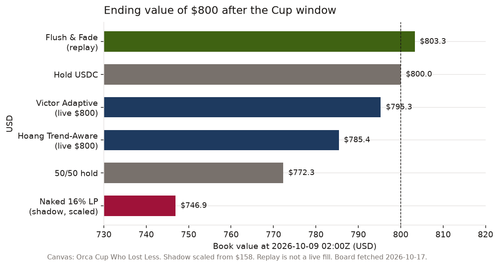

# Czfq Cup shadow: who earns, why we lost −6.6%, and dump-protected v1

Substack-ready narrative (In and Out voice, $800 scale): [`in-and-out-orca-cup.md`](in-and-out-orca-cup.md).

**Superseded 2026-10-17.** The sleeve + −3% kill below only lost less (−3.5% replay). The public letter uses Flush & Fade.



*Charts, the rule, and the next trial: [`in-and-out-orca-cup.md`](in-and-out-orca-cup.md).*

We ran the Cup-shaped 16% / 0.5 bot on Orca’s big SOL-USDC pool (`Czfq3xZZ…`). SOL dumped. Mark-to-market went **~$158 → ~$148 (−6.64%)** in 48h while fees were only about **$0.63**. The confusing question afterward: *Czfq is huge — who is making money?*

This post is an honest postmortem and a reliability roadmap. Numbers come from the Cup shadow ledger / equity series (`data/cup_race_autotimer/equity_48h.json`). No unfinished live P&L claims beyond that.

## What we ran

- **Host:** Mac shadow race (Amphetamine + LaunchAgents), not Botcamp $800.
- **Pool:** Orca Whirlpool SOL-USDC `Czfq3xZZDmsdGdUyrNLtRhGc47cXcZtLG4crryfu44zE` (0.04% fee tier).
- **Shell:** `lp_rebalancer` width **16%**, rebalance threshold **0.5**, `position_offset_pct: 0`, quote ~120 (`configs/lp_rebalancer_s001_120.yml`).
- **Window:** Botcamp Cup hours `2026-10-07T02:00Z` → `2026-10-09T02:00Z`.
- **Result:** open book **$158.08**, close **$147.59**, return **−6.64%**; fees ~$0.63 (fees-implied volume ~$1.6k). Hourly equity SD ~0.53%.

Wide-band LP stayed mostly in range and collected a trickle of fees. It also held a SOL/USDC inventory through a one-way dump. Fees did not come close to covering divergence loss.

## Why it failed (for our goal)

Orca’s own framing is the right payoff model: **net LP return ≈ fees − divergence loss** ([understanding LP returns](https://docs.orca.so/liquidity/concepts/understanding-lp-returns)). Our Cup shadow failed the trend case:

1. **Inventory risk, not “delta-neutral MM.”** A 16% band is still long a mix of SOL and USDC. When SOL falls hard, the position absorbs inventory.
2. **Fee budget too small.** On a 0.04% tier, ~$0.63 of fees cannot offset a ~10% SOL move over 48h on a ~$158 book.
3. **No risk budget.** Offset was 0 (centered 50/50 open). There was no cash sleeve and no equity kill, so we rode the full dump.

Cup **Volume** (fees-implied) and personal **MTM** are different goals. We scored some volume and still lost money.

## Plain English: hold USDC vs LP

| Phrase | Literal meaning |
|--------|-----------------|
| Don’t LP | Close any Whirlpool position; do **not** deposit into Czfq. |
| Hold USDC | Wallet stays ~100% USDC (plus dust SOL for rent/gas only). |
| No SOL dump loss | If SOL −20%, your USDC balance is unchanged (ignore SOL dust). You did **not** underwrite the dump. |
| No fees | You earn **$0** swap fees — you are not in the fee stream. |
| No Cup “volume” | Botcamp Volume = fees-implied; no position ⇒ no scored volume. |

**Hold USDC** is the risk-free-to-SOL baseline, not a trading strategy. Every trial should beat it on MTM after fees and gas — or we should refuse to be the LP.

```text
Hold_USDC:     wallet USDC → no SOL inventory → no swap fees
Naked_16%_LP:  deposit SOL+USDC → earn fees in band → divergence on trend
Dump_prot_v1:  cash sleeve USDC → LP slice (USDC-heavy offset) → kill at −3%
```

## Who earns in a huge pool like Czfq

Large TVL does **not** mean LPs are printing. It means someone is willing to be the bid and offer.

1. **Swappers / flow traders** — pay 0.04% (+ impact) for instant SOL↔USDC. They win when their edge elsewhere (urgency, hedging, venue arb) exceeds that cost. The pool is their **tool**, not their yield farm.
2. **Orca protocol** — takes a cut of swap fees (docs framing: roughly ~87% to LPs, ~12% DAO, ~1% climate). That cut scales with volume whether any single LP beats HODL.
3. **LPs who win** — those whose **fees > divergence loss**: often tight/active managers in chop, or inventory that matches a deliberate view. Many passive CLMM LPs do **not** beat HODL (Orca’s own framing; third-party position studies often land around ~1/3 of positions beating HODL in short windows).
4. **Not “pumpers and dumpers” as a class of LP winners.** Directional traders can profit **outside** the pool. When they dump through Czfq, **LPs absorb inventory**. Dumpers are often *why* naked LPs lose — not who harvests the fee stream.

Reliability comes from **when you choose to be that someone**, and when you refuse (hold USDC / kill).

## Dump-protected v1 (same Czfq 16% shell, no swarm)

Venue rule for this repo: **Orca / Solana only**. No Hyperliquid / CEX perps in the executable stack. Industry hedges can exist elsewhere; they are not our v1.

| Knob | Value | Why |
|------|-------|-----|
| Pool / width / thr | Czfq / **16%** / **0.5** | Keep race shell; change risk, not band thesis |
| Book | ~$150–160 available | Post-race wallet |
| **Cash sleeve** | **40% USDC never deposited** | Hard dump buffer (~$60) |
| **LP notional** | **60%** → `total_amount_quote: 90` | Smaller SOL inventory |
| **Offset** | `side: BUY`, `position_offset_pct: -4.0` | HB: negative offset = in-range; BUY + negative puts spot in the **upper** band → **USDC-heavy** at open (`RANGE` ignores offset) |
| **−3% kill** | Flatten all LPs → USDC if `equity ≤ open × 0.97` | Companion script + LaunchAgent; not trusted to `lp_rebalancer` alone |
| Executable “hedge” | Cash sleeve (40%) | Paper line only: full hedge ≈ short SOL delta of the LP |
| Swarm / arb | Out of scope | Separate edge book later |

Artifacts:

- Spec: [`docs/DUMP_PROTECTED_SPEC.md`](../DUMP_PROTECTED_SPEC.md)
- Config: [`configs/lp_rebalancer_dump_protected_120.yml`](../../configs/lp_rebalancer_dump_protected_120.yml)
- Kill: [`scripts/equity_kill.py`](../../scripts/equity_kill.py) + [`scripts/com.hummingbot.equity-kill.plist`](../../scripts/com.hummingbot.equity-kill.plist)
- Offline appendix: [`docs/blog/czfq-dump-protected-replay.md`](czfq-dump-protected-replay.md)

Two-sentence summary: naked 16% LP lost because fees were tiny versus SOL inventory on a dump, with no kill. Dump-protected v1 keeps the same band but leaves 40% in USDC, opens USDC-heavy, and flattens at −3% so we refuse another −6% ride.

## Reliability going forward

1. Every trial reports MTM vs **hold USDC** and vs **50/50 HODL**.
2. Kill fires are logged (`data/equity_kill/`); no silent “it felt fine.”
3. No redeploy without an explicit risk budget (sleeve + offset + kill).
4. Stop-flat must close **all** positions and confirm on-chain (Cup orphan lesson).

## What we are not doing yet

- Arb / inventory swarm (separate P&L stream; does not remove SOL beta from the LP book).
- CEX or perp hedges (venue rule: Orca / Solana only for executable strategy).

When those show up, they get their own trial rows — not a silent fork of `decide()` or a second policy.
